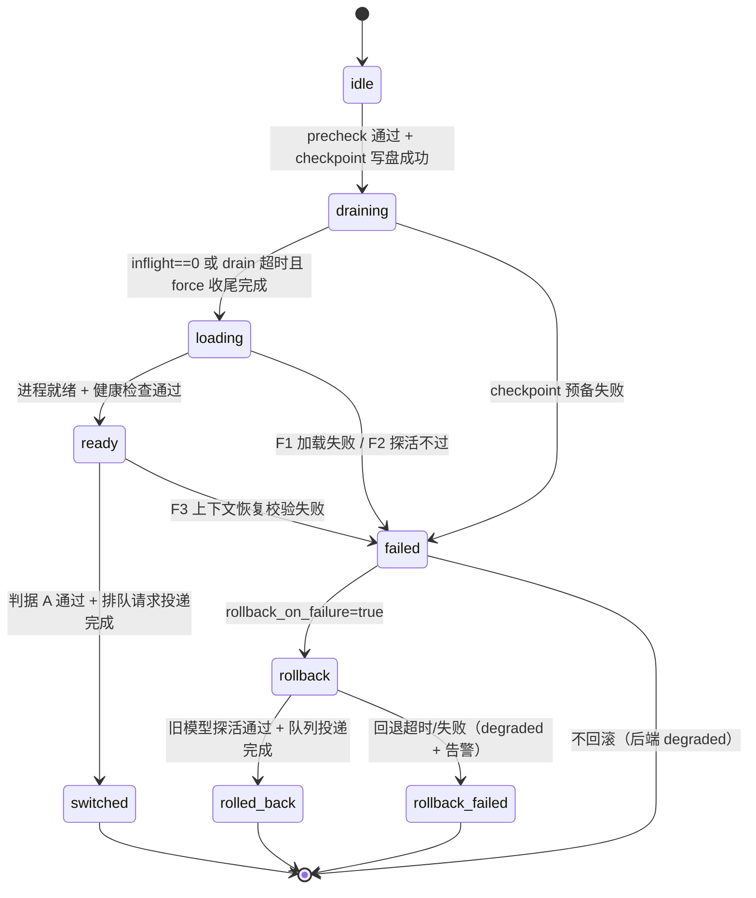

# PRD-230/T1 本地模型热切换设计

| 项 | 值 |
|---|---|
| 文档编号 | PRD-230/T1-design |
| 对应需求 | PRD-230「llama-swap 式本地模型热切换」 |
| 对应 trend issue | #1150（设计评审通过，三项要求定义明确） |
| 状态 | Draft（待设计评审） |
| 前置依赖 | PRD-060（协议归一层，输出格式归一）；PRD-059（failover）；PRD-173（云端 BYOS，边界外） |
| 关联任务 | T2 实现、T3 联调、T4 故障注入验收 |

## 0. 背景与范围

### 0.1 目标

open-free-router 的**本地后端**支持会话中途热切换模型，做到四点：

1. **不断线**：切换期间客户端连接不被重置，请求不因切换被静默丢弃；
2. **不丢上下文**：会话上下文在切换前后完整保持（清单见 §2.1）；
3. **格式一致**：切换前后同一会话的输出经 PRD-060 归一层后对外形态一致（定义见 §3.2）；
4. **可回退**：新模型加载失败 / 健康检查不过 / 假健康时，能自动回退到原模型。

### 0.2 借鉴声明

本文借鉴 mostlygeek/llama-swap 的**产品形态**：单机、显存受限场景下"卸旧载新"的换页式模型切换，配合上游以无状态方式注入对话上下文。**其内部协议细节未核实，本文所有接口、字段、状态机均为 open-free-router 自行设计，不复用其任何代码。**

### 0.3 系统位置与边界

- 新增组件 **Hot-Swap Manager**，位于本地后端适配层：其上是 PRD-060 归一层（本设计不改归一层映射规则，只消费并约束它），其下是模型进程管理（启动/停止/探活本地推理进程，示例地址一律 `http://localhost:<port>`）。
- 与 PRD-059 failover 的边界：failover 是**跨后端**的被动故障响应；本设计是**同一本地后端内换模型**的主动运维操作。回退失败（`rollback_failed`）时升级交给 PRD-059 在后端间选择替代，本设计不重复建设。
- 与 PRD-173 的边界：云端 BYOS 后端不在本设计范围（见 §5）。

## 1. 热切换协议设计

### 1.1 触发方式与 API

热切换通过管理 API 触发（形态：HTTP + JSON）。基址占位为 `http://localhost:<port>`。

**`POST /v1/admin/hot-swap` — 发起切换**

请求字段：

| 字段 | 类型 | 必填 | 默认 | 说明 |
|---|---|---|---|---|
| `request_id` | string | 是 | — | 幂等键；同 id 重复提交返回同一 swap 的当前状态，不重复触发 |
| `target_model` | string | 是 | — | 目标模型标识，须在本地模型注册表中存在，如 `model-b` |
| `strategy` | enum | 否 | `unload-then-load` | `unload-then-load`（卸旧载新，T1 承诺语义）/ `parallel-load`（双缓冲，仅接口预留，见 §1.3） |
| `drain_timeout_ms` | int | 否 | 30000 | 排空在途请求的预算，超时后进入 force 收尾 |
| `force_on_drain_timeout` | bool | 否 | true | 超时后是否强制收尾仍在流的请求（补发合法终结帧） |
| `new_request_policy` | enum | 否 | `queue` | 切换期间新请求策略：`queue` / `reject` / `passthrough-old`（见 §1.4） |
| `queue_timeout_ms` | int | 否 | 180000 | 排队请求等待上限，须 ≥ 切换总预算（公式见 §1.3） |
| `health_check` | object | 否 | 见下 | `{probe_path:"/health", timeout_ms:5000, retries:3, interval_ms:2000}` |
| `loading_timeout_ms` | int | 否 | 120000 | 新模型进程启动 + 就绪的超时 |
| `rollback_on_failure` | bool | 否 | true | 失败后是否自动回退到 `previous_model` |
| `rollback_timeout_ms` | int | 否 | 120000 | 回退流程的超时 |
| `context_truncation` | enum | 否 | `reject-swap` | 新模型窗口不足时的策略：`reject-swap`（拒绝切换）/ `oldest-first`（截最旧轮次，须显式选配） |
| `observation_window_s` | int | 否 | 300 | 切换成功后的假健康观察窗（F5，见 §4.1） |
| `dry_run` | bool | 否 | false | 只执行 precheck，不实际切换 |
| `callback_url` | string | 否 | — | 切换到达终态时的回调，占位 `http://localhost:<port>/callbacks/swap` |

**precheck（进入 `draining` 之前全部通过，任一不过即 `rejected`）**：

| 检查 | 不过时的错误码 |
|---|---|
| `target_model` 已在本地注册 | `model_not_registered`（404） |
| 模型文件已下载完整（不做下载，见 §5） | `model_not_downloaded`（422） |
| 显存预算：目标权重 + KV cache 余量 ≤ 可用显存 | `insufficient_vram`（422） |
| 最大活跃会话 token 估算 ≤ 目标 context_window × 0.9（token 估算用 PRD-060 的 `estimate_tokens(messages)`） | `insufficient_context_window`（422） |
| 目标模型在"归一层覆盖矩阵"中标记为已覆盖（T2 产出，见 §6 R2） | `normalization_gap`（422） |
| 会话 checkpoint 可写盘（写盘成功才允许进入 draining） | `checkpoint_failed`（500） |
| 当前无进行中的 swap | `swap_in_progress`（409） |

响应（202，`rejected` 时为对应 4xx/5xx）：

```json
{
  "request_id": "swap-req-0001",
  "swap_id": "swap-0001",
  "status": "accepted",
  "trigger": "api",
  "previous_model": "model-a",
  "target_model": "model-b",
  "state": "draining",
  "inflight_count": 3,
  "queued_count": 1,
  "precheck": {"vram_ok": true, "context_window_ok": true, "normalization_ok": true},
  "rejected_reason": null
}
```

**查询接口**：

- `GET /v1/admin/hot-swap/{swap_id}`：返回 swap 对象（`swap_id`、`state`、`previous_model`、`target_model`、`trigger`、各阶段进入时间戳、`inflight_count`、`queued_count`、`error{code, phase, message}`、`events[]`——每次状态迁移一条事件 `{from, to, at, detail}`）。
- `GET /v1/admin/hot-swap/current`：返回后端当前 `model`、`state`（`idle` 或某 swap 阶段）、`last_swap_id`。

### 1.2 切换时序：排空（drain-then-load）vs 双缓冲

**取舍结论：默认且 T1 只承诺 `unload-then-load`（先排空→卸载旧模型→加载新模型）；`parallel-load`（双缓冲，新旧并存、零等待切换）仅作为接口预留的优化路径。**

理由：

1. 本设计的目标场景与 llama-swap 相同——**单机显存受限**。双缓冲要求同时驻留两份权重 + 两份 KV cache，消费级 GPU 通常装不下，一旦 OOM 双模型全灭，与"可回退"目标冲突；
2. 双缓冲只能在显存充裕时提供秒级切换，收益限于少数大显存机器，而 drain-then-load 对所有机器可用；
3. drain-then-load 的切换等待可以通过排队 + SSE 心跳（§1.4）对客户端屏蔽，代价可控。

时序步骤（时间预算公式：`T_swap ≤ drain_timeout + t_unload + loading_timeout + (retries×interval + timeout) + 5s_restore`；按默认值上界约 170s，故 `queue_timeout_ms` 默认 180000）：

1. **T0 接受**：precheck 全过 + checkpoint 写盘成功 → 进入 `draining`；
2. **T1 排空**：等待在途请求结束——非流式等完整响应返回；流式等自然 `data: [DONE]`。排空完成条件：`inflight_count == 0`；或 `drain_timeout_ms` 到期进入 force 收尾（见 §1.4）；
3. **T2 卸载**：停止旧模型进程、释放显存；
4. **T3 加载**：启动 `target_model` 进程，等待就绪；
5. **T4 探活**：按 `health_check` 配置探测，通过即进入 `ready`；
6. **T5 恢复与校验**：执行上下文判据 A 的自动比对（§2.3），通过后按到达顺序把排队请求投递给新模型；
7. **T6 完成**：队列投递完成 → `switched`。切换点必然落在**两个请求的边界**上，不做"半路改道"（流中请求要么旧模型收尾、要么 force 终止，见 §2.2 第 5 条）。

### 1.3 切换期间新请求的处理策略

| 策略 | 行为 | 适用 |
|---|---|---|
| `queue`（**推荐默认**） | 新请求进入 FIFO 队列，切换成功后按序投递给新模型；流式请求**立即回 200 并周期发送 SSE 注释心跳** `: hot-swap in progress (swap_id=...)`（每 5s，符合 SSE 规范、不影响 data 帧解析），防止客户端/代理空闲超时；非流式请求静默等待。排队超过 `queue_timeout_ms` 返回 `503 model_switching` + `Retry-After` + `swap_id` | 默认 |
| `reject` | 新请求立即 `503 model_switching` + `Retry-After` | 调用方自带重试且不希望心跳的场景 |
| `passthrough-old` | 新请求继续投给旧模型 | **仅 `parallel-load` 策略下合法**，`unload-then-load` 下不可选（旧模型已卸载） |

**推荐 `queue` 的理由**：①"不断线"的体验要求是请求不因切换被拒，`reject` 把切换成本外溢给调用方；②drain-then-load 下旧模型正在卸载，`passthrough-old` 不可行；③排队 + 心跳 + 超时兜底的组合已覆盖客户端等待问题。切换失败回滚后，队列不丢弃，回滚完成即投给回滚后的旧模型（§4.2）。

### 1.4 切换状态机



迁移表（含进入动作；每次迁移写一条事件到 `events[]`）：

| 从 | 到 | 触发条件 | 进入动作 |
|---|---|---|---|
| idle | draining | precheck 全过 + checkpoint 写盘成功 | 新请求按策略入队；开始排空计时 |
| draining | loading | `inflight_count==0`，或 drain 超时且 force 收尾完成 | 卸载旧模型；启动新模型进程 |
| loading | ready | 新模型就绪且探活通过 | 启动上下文校验与队列投递 |
| ready | switched | 判据 A 比对通过 + 排队请求全部投递完成 | 记录 `switched_at`；开启观察窗 `observation_window_s` |
| draining / loading / ready | failed | 对应 F1–F3（§4.1）或预备失败 | 记录 `error{code, phase}`；隔离新模型（quarantine，默认 600s 内不可再被选为切换目标） |
| failed | rollback | `rollback_on_failure=true` | 重新拉起 `previous_model`；队列保留 |
| rollback | rolled_back | 旧模型探活通过 + 队列投递完成 | 后端恢复服务；`state=idle` |
| rollback | rollback_failed | `rollback_timeout_ms` 超时或拉起失败 | 后端 degraded：所有请求 `503 no_backend_available`；告警升级人工 |
| switched | （新 swap） | 观察窗内 F5 触发 | 发起 `trigger=auto_rollback` 的新 swap（previous/target 互换），`switched` 仍为本 swap 终态 |

互斥约束：**同一后端同一时刻至多一个活跃 swap**（单写者），并发请求返回 `409 swap_in_progress`。任何 swap 必达终态 `switched` / `rolled_back` / `rollback_failed` / `failed`（不回滚）之一，禁止中间态悬挂。

## 2. 上下文保持要求

### 2.1 必须保持的内容清单

| # | 类别 | 具体内容 | 允许变化 |
|---|---|---|---|
| 1 | 对话历史 | 会话 `messages` 数组：全部 user/assistant/tool 轮次，含 `tool_calls`、tool 结果、多模态内容引用 | 否 |
| 2 | 系统提示 | 会话级 `system` prompt（含其内嵌指令） | 否 |
| 3 | 生成参数 | `temperature`、`top_p`、`max_tokens`、`stop`、`seed`、`presence_penalty`、`frequency_penalty` 及调用方传入的自定义键（未知键原样透传保留） | 否 |
| 4 | 会话元数据 | `session_id`、创建时间、会话状态、usage 累计（prompt/completion tokens，跨切换连续累加） | 否 |
| 5 | 模型标识 | 当前模型名 / `model` 字段 | **是（唯一例外）**：切换后指向新模型，须如实变更 |

**明确不承诺**：KV cache 不迁移。不同模型架构的 KV cache 不兼容，本设计只保持文本层上下文，切换后由新模型重新 prefill。KV cache 重建延迟属于性能差异，不属于"上下文丢失"。

### 2.2 保持机制设计约定

1. **权威源在 router**：会话上下文的权威存储是 open-free-router 的会话存储（会话记录已由 PRD-060 归一为协议无关形态），模型进程一律无状态——每个推理请求由 router 注入完整上下文。因此**热切换单元 = 模型实例，与会话存储完全解耦**，换模型天然不动会话数据。
2. **切换前 checkpoint**：进入 `draining` 前写 swap checkpoint，内容：`swap_id`、时间戳、活跃会话清单、每会话 `last_request_seq`、messages 快照哈希、params 快照。checkpoint 写盘失败则拒绝切换（§1.1 precheck），杜绝半切换状态。
3. **恢复方式 = 校验而非注入**：`ready` 阶段不需要向新模型"搬运"历史（每请求本来全量注入）；该阶段做两件事：对 checkpoint 做判据 A 自动比对；对一条探针会话发一次真实请求验证新模型可承接（其余会话惰性恢复，首个请求自然携带全量上下文）。
4. **窗口不足不允许静默截断**：precheck 以 `insufficient_context_window` 拒绝（默认）；只有调用方显式选配 `context_truncation: oldest-first` 才截最旧轮次，且截断事实写入会话事件日志——静默截断视为"丢上下文"。
5. **切换点只在请求边界**：drain 语义保证不把半截响应嫁接给新模型。被 force 收尾的流，router 补发合法终结帧：空 `delta` + `finish_reason: "aborted_by_swap"`（OFR 扩展枚举值，PRD-060 归一层须透传；客户端按未知 finish_reason 处理为终止即可）+ `data: [DONE]`，并在响应头携带 `x-ofr-swap-id`。已生成的部分文本作为完整 assistant 消息计入会话历史。

### 2.3 验收判据（判定"上下文没丢"）

| 判据 | 内容 | 执行时机 |
|---|---|---|
| **A 全等回放** | 切换前 dump 会话（messages + system + params）与 checkpoint 哈希；`ready` 阶段自动比对切换后 router 内的会话记录，规范化 JSON 逐字段全等（§2.1 允许变化的"模型标识"除外） | 每次 swap 自动执行，不等则进 `failed` |
| **B 延续性探针** | 切换前向探针会话写入随机事实（"暗号是 `<random-token>`"）；切换后用新会话请求询问暗号，回答须包含该 token | 验收测试 + 每次 swap 的探针会话 |
| **C 参数保持** | 切换前后各发一次带相同 params 的请求，router 日志记录的注入 params 全等 | 验收测试 |
| **D 统计连续** | 会话 usage 累计值在切换前后连续累加，无清零、无跳变 | 验收测试 |
| **E 终结合法** | 所有 force 收尾的流均为合法 SSE 终结（`finish_reason: aborted_by_swap` + `[DONE]`），无半帧、无悬挂连接 | 每次 swap 自动统计 |

## 3. 输出格式一致性要求

### 3.1 对 PRD-060 归一层的前提（依赖声明）

1. 所有本地后端响应经过 PRD-060 归一层，对外只有一种 OpenAI 兼容形态；本设计**不重新定义归一逻辑**，只定义"切换不得引入新差异"的约束与校验方法。
2. 归一层须提供：字段结构归一（§3.2-1）、流式分片归一（§3.2-2）、tool_calls 增量拼接、`estimate_tokens()`、扩展枚举 `aborted_by_swap` 的透传。
3. 归一层对未知模型特有字段的丢弃/映射规则是 PRD-060 的职责；热切换通过 precheck 的覆盖矩阵（§6 R2）保证目标模型已被归一层覆盖，从而**不放大**覆盖度问题。

### 3.2 "切换前后输出格式一致"的定义

**1）字段结构（非流式响应）**：切换前后同一会话的响应满足同一 JSON Schema——必填字段 `id:string`、`object:"chat.completion"`、`created:int`、`model:string`、`choices[].index:int`、`choices[].message{role:"assistant", content:string|null, tool_calls?:[{id, type:"function", function:{name, arguments}}]}`、`choices[].finish_reason ∈ {stop, length, tool_calls, content_filter, aborted_by_swap}`、`usage{prompt_tokens, completion_tokens, total_tokens}`。唯一允许值不同的字段是 `model`（如实返回当前模型名，默认 `model_field_policy: "actual"`；可选 `session-alias` 固定为会话创建时的别名，供要求完全无感的调用方）。无论哪种策略，响应头附 `x-ofr-actual-model: <实际模型>`，切换后的响应再附 `x-ofr-swap-id`。

**2）流式分片形态**：chunk 均为 `object:"chat.completion.chunk"` 且满足规则集 R1–R6，切换前后同等成立：

| 规则 | 约束 |
|---|---|
| R1 | 首个 data chunk 的 `delta` 含 `role:"assistant"`，且全流仅出现一次 |
| R2 | 后续 chunk 的 `delta` 只含 `content`、`tool_calls` 增量或为空对象 |
| R3 | `finish_reason` 至多出现在最后一个 data chunk |
| R4 | 终结 `data: [DONE]` 必须存在且唯一 |
| R5 | 错误以 `data: {"error": ...}` 帧表达后关闭流，不得裸断 |
| R6 | SSE 注释行（`:` 开头，如切换心跳）允许存在，且不得影响 data 帧解析 |

**一致性红线（避免过度承诺）**：格式一致 ≠ 内容一致——不要求切换前后输出逐字相同（模型不同必然不同）；不承诺首 token 延迟与吞吐一致（性能差异允许，不计入一致性验收）。禁止的切换特有畸形：`[DONE]` 缺失、role 帧重复、`finish_reason` 出现两次、同一请求被两个模型各答半截。

### 3.3 一致性校验方法

| 方法 | 内容 |
|---|---|
| C1 schema 抽检 | 切换前后各采样 ≥20 条响应（10 非流式 + 10 流式），对同一 JSON Schema 校验，通过率 100% |
| C2 流序列校验器 | 实现 R1–R6 规则集的校验器，对切换前后样本跑同一校验，同等 100% 通过；输出 chunk 级报告 |
| C3 结构探针 | 同一会话切换前后发送同一结构化探针请求（`temperature=0`、`seed` 固定），只校验结构（JSON 可解析、usage 字段存在、finish_reason 合法），不做逐字比对 |
| C4 CI 门禁 | C1–C3 接入回归流水线与 T4 故障注入流水线，作为切换验收的自动断言 |

## 4. 失败回滚要求

### 4.1 失败分类

| 码 | 场景 | 判定 |
|---|---|---|
| F1 | 新模型加载失败 | 进程启动报错 / 退出 / `loading_timeout_ms` 超时 |
| F2 | 健康检查不过 | `health_check.retries` 耗尽仍探活失败 |
| F3 | 上下文恢复失败 | `ready` 阶段判据 A 比对失败，或探针会话请求报错（含运行期 context window 报错） |
| F4 | 排队超时 | 非模型失败；触发 §1.3 的 503 兜底，不进入回滚 |
| F5 | 假健康 | 探活通过但观察窗（默认 300s）内错误率 > 50% 或连续 5 次推理连接失败/5xx |

### 4.2 回退流程

1. F1/F2/F3 任一发生 → `failed`：记录 `error{code, phase, detail, swap_id}`；将 `target_model` 标记 **quarantined**（默认 600s 冷却，期间不可被选为切换目标，防止回退-重试震荡）；
2. `rollback_on_failure=true` → `rollback`：停止对新模型发请求；重新拉起 `previous_model`；探活通过 → `rolled_back`；
3. **排队请求不丢弃**：回滚完成后按原到达顺序投给旧模型；个别请求排队时长已超 `queue_timeout_ms` 的，逐条按 §1.3 超时策略返回 503；
4. F5 走独立路径：`switched` 后观察窗内触发 `trigger=auto_rollback` 的新 swap（previous/target 互换，自动发起），同样以 `rolled_back` 收尾；
5. `rollback_failed`：旧模型也拉不起来（`rollback_timeout_ms` 超时或进程失败）→ 后端 degraded，所有请求 `503 no_backend_available` + 告警升级人工，同时交由 PRD-059 在后端间选择替代。

### 4.3 回退期间会话状态约定

- 会话不失效、不重建、`session_id` 不变；F1–F3 场景下切换从未生效，会话数据与 checkpoint 保持一致即可；
- F5 场景下新模型已产生若干响应：**这些响应保留在历史中**（用户已看到，删除即撒谎），逐条如实记录 `model` 为新模型名；回退后旧模型继续追加；
- 回退全程会话存储可写、新请求照常入队，恢复后自动续跑。

### 4.4 回滚验收判据（对应 T4 故障注入）

| 判据 | 内容 |
|---|---|
| RB-1 | 注入 F1（目标模型路径无效/权重损坏）：终态 `rolled_back`，恢复耗时 ≤ `rollback_timeout_ms` |
| RB-2 | 注入 F2（探活端点挂起）：retries 耗尽 → `rolled_back` |
| RB-3 | 注入 F5（探活过但推理全 5xx）：观察窗触发 `auto_rollback` → `rolled_back` |
| RB-4 | 切换期间发出的每个请求都有终态：∈ {正常响应、`aborted_by_swap` 合法终结流、503}，无悬挂流、无 connection reset |
| RB-5 | 回滚后判据 A/B 复验通过（上下文仍完整） |
| RB-6 | 幂等与收口：重复注入不产生死锁；状态机必达四个终态之一 |
| RB-7 | 注入"旧模型也拉不起"：进入 `rollback_failed` → degraded + `503 no_backend_available` + 告警事件产生 |

## 5. 非目标声明

1. **不做云端后端热切换**：PRD-173 BYOS 云端后端的模型切换不在本设计范围，本设计仅约束本地后端；
2. **不做模型下载与管理**：不做下载、版本管理、磁盘清理；模型"本地已注册且已下载"是 precheck 前置条件；
3. **不做多机/多副本编排**：仅单机本地后端；
4. **不做 KV cache 迁移**与投机性 prefill 优化；
5. **不改 PRD-060 归一层本身的映射规则**（只提需求：透传 `aborted_by_swap`、`estimate_tokens`）。

## 6. 风险与对策

| # | 风险 | 设计层对策 |
|---|---|---|
| R1 | 切换瞬间排队超时（本地大模型加载可达分钟级） | SSE 心跳防空闲超时；`queue_timeout_ms` 与切换预算公式挂钩（§1.2）；超时返回 503 + `Retry-After` + `swap_id` 供调用方精确重试；`loading_timeout_ms` 可按模型档位预配置 |
| R2 | 归一层覆盖度不足（目标模型输出含未归一字段） | precheck 的归一层覆盖矩阵门禁（`normalization_gap` 拒切）；`dry_run` 支持提前探测；矩阵由 T2 维护并纳入 C1/C2 校验 |
| R3 | 显存不足致加载失败率高 | precheck 显存预算估算（权重 + KV 余量），不足即 `insufficient_vram` 拒切，宁可拒切不做必败切换 |
| R4 | drain 卡死（超长流式不停） | `drain_timeout_ms` + force 收尾产出合法终结帧（§2.2-5），不无限等待 |
| R5 | 并发切换竞态 | 单写者互斥 + `409 swap_in_progress` + `request_id` 幂等 |
| R6 | checkpoint 失败与切换叠加造成半切换 | 写盘成功才进 `draining`；回滚以 checkpoint 为校验基准 |
| R7 | 长会话 token 超新模型窗口 | precheck `insufficient_context_window` 默认拒切；显式选配才截断且留痕 |
| R8 | 观测盲区（切换成败说不清） | swap 事件流（`events[]`）+ `x-ofr-swap-id` 贯穿请求日志 + 判据 A/E 自动统计 |

## 7. 验收点清单（对应 trend issue #1150）

| # | 验收点 | 对应章节 |
|---|---|---|
| ACC-01 | 切换协议 API 定稿：请求/响应字段表、precheck 项与错误码、查询接口 | §1.1 |
| ACC-02 | 切换时序定稿：默认 drain-then-load，双缓冲取舍理由与预留方式明确 | §1.2 |
| ACC-03 | 切换期间新请求策略定稿：默认 queue + 心跳 + 超时兜底，理由明确 | §1.3 |
| ACC-04 | 状态机定稿：状态、迁移表、进入动作、单写者互斥、必达终态 | §1.4 |
| ACC-05 | 上下文保持清单定稿：5 类内容 + KV cache 不承诺范围 + 唯一例外字段 | §2.1–2.2 |
| ACC-06 | 上下文验收判据 A–E 定义完整且可自动执行 | §2.3 |
| ACC-07 | 格式一致性定义定稿：字段结构 + 流式规则集 R1–R6 + 一致性红线 | §3.2 |
| ACC-08 | 一致性校验方法 C1–C4 定稿并预留 CI/T4 挂点 | §3.3 |
| ACC-09 | 失败分类 F1–F5 与回退流程（含 quarantine、观察窗、degraded）定稿 | §4.1–4.3 |
| ACC-10 | 回滚验收判据 RB-1–RB-7 与 T4 故障注入项一一对应 | §4.4 |
| ACC-11 | 非目标边界确认：不做云端后端热切换、不做模型下载与管理 | §5 |
| ACC-12 | 风险对策表评审通过，R1–R8 无未闭环项 | §6 |
| ACC-13 | 三项核心要求（切换协议 / 上下文保持 / 格式一致性）各自有独立、可验收的定义章节，设计评审通过 | §1–§3 |

*本文档由 pi（GLM-5.3）起草、Muse 验收。*
